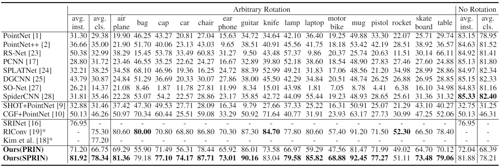
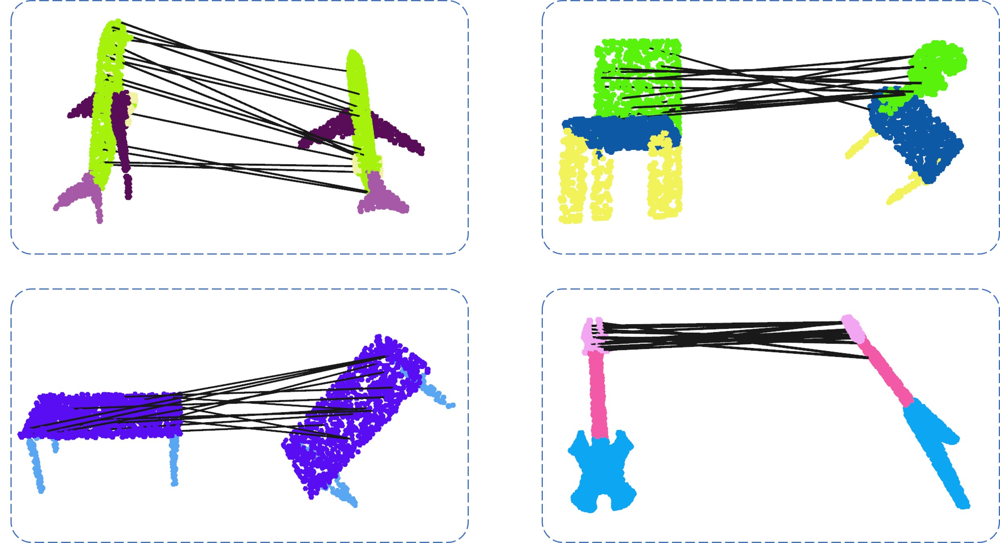

# PRIN/SPRIN: On Extracting Point-wise Rotation Invariant Features

[](https://doi.org/10.1109/TPAMI.2021.3130590)
[](https://arxiv.org/abs/2102.12093)
[](https://huggingface.co/qq456cvb/SPRIN)

PyTorch implementation of **PRIN/SPRIN: On Extracting Point-wise Rotation Invariant Features** (IEEE TPAMI 2022), an improved and extended version of [our AAAI 2020 work PRIN](https://github.com/qq456cvb/PRIN).

Point cloud analysis without pose priors is challenging because object orientations are often unknown in real applications. **PRIN** (Point-wise Rotation Invariant Network) extracts per-point rotation-invariant features through Density Aware Adaptive Sampling, Spherical Voxel Convolution, and Point Re-sampling. **SPRIN** is its sparse variant that operates directly on sparse point clouds, achieving state-of-the-art results on randomly rotated point clouds without any rotation augmentation.

## News
- **[2022-03]** Our new sim-to-real 9D pose estimation method [CPPF](https://github.com/qq456cvb/CPPF) that leverages SPRIN *SE(3)*-invariant features is accepted to CVPR 2022.

## Results

### ShapeNet Part Segmentation


### Feature Matching for PRIN


## Getting Started

### Dataset

Download the ShapeNet part segmentation dataset from https://shapenet.cs.stanford.edu/media/shapenet_part_seg_hdf5_data.zip and extract it to `shapenet_part_seg_hdf5_data/` under the repository root.

### Pretrained Weights

Pretrained checkpoints for both models are hosted on [Hugging Face](https://huggingface.co/qq456cvb/SPRIN):

```bash
hf download qq456cvb/SPRIN epoch250.pt --local-dir sprin   # SPRIN
hf download qq456cvb/SPRIN state79.pkl --local-dir prin    # PRIN
```

Google Drive mirrors: [SPRIN](https://drive.google.com/file/d/1ZwN0bJ3UgCJheqYcUrEZyHIH8tEgk3cR/view?usp=sharing), [PRIN](https://drive.google.com/file/d/116c80nvL6jAK4T75d5IMudgI8KRcMFa0/view?usp=sharing).

### Train and Test

SPRIN depends only on PyTorch and [hydra](https://hydra.cc/):

```bash
python sprin/train.py   # train
python sprin/test.py    # evaluate with sprin/epoch250.pt
```

PRIN additionally requires the modified [s2cnn](https://github.com/qq456cvb/s2cnn) submodule and a C++ module for Density Aware Adaptive Sampling; see [prin/README.md](prin/README.md) for setup, then:

```bash
python prin/train.py    # train
python prin/test.py     # evaluate with prin/state79.pkl
```

Training hyperparameters are configured in `prin/config/shapenet.yaml` and `sprin/config/shapenet.yaml`.

## License

MIT

## Citation

```bibtex
@article{you2022prin,
  title={PRIN/SPRIN: On Extracting Point-wise Rotation Invariant Features},
  author={You, Yang and Lou, Yujing and Shi, Ruoxi and Liu, Qi and Tai, Yu-Wing and Ma, Lizhuang and Wang, Weiming and Lu, Cewu},
  journal={IEEE Transactions on Pattern Analysis and Machine Intelligence},
  volume={44},
  number={12},
  pages={9489--9502},
  year={2022},
  doi={10.1109/TPAMI.2021.3130590}
}
```
